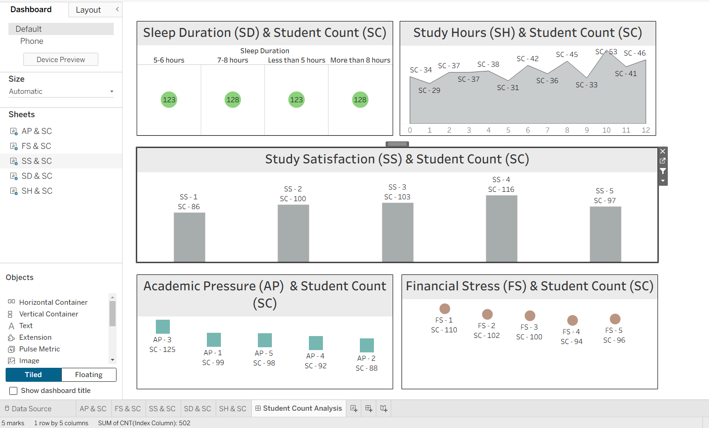

# 1. Student Depression Analysis | SQL & Tableau

An exploratory data analytics project using SQL Server and Tableau to analyze student depression-related indicators and their relationships with academic pressure, study satisfaction, sleep duration, study hours, and financial stress.

## Project Overview

The objective of this project is to explore student-related factors associated with depression using SQL for data preparation and Tableau for data visualization.

The project involves examining different student attributes, preparing the dataset through SQL queries, and building visual comparisons to understand patterns across the available data.

## Tools & Technologies

- **Microsoft SQL Server** – Database management and data preparation
- **SQL** – Data cleaning, transformation, aggregation, and analysis
- **Tableau** – Data visualization and dashboard development
- **CSV** – Source dataset

## Repository Structure

```text
02-SQL-Tableau-Student-Depression-Analysis/
│
├── Dataset/
│   └── Student_Depression_Dataset.csv
│
├── SQL/
│   └── sql_comand.sql
│
├── Tableau/
│   └── Tableau_sheet.twb
│
├── Screenshots/
│
└── README.md
```

## Dataset Description

The project uses a student depression dataset containing the following attributes:

- Gender
- Age
- Academic Pressure
- Study Satisfaction
- Sleep Duration
- Dietary Habits
- Suicidal Thoughts
- Study Hours
- Financial Stress
- Family History of Mental Illness
- Depression

## SQL Data Preparation & Analysis

SQL Server was used to inspect, prepare, and transform the dataset.

Key operations include:

- Creating and selecting the project database.
- Analyzing gender distribution using `GROUP BY`.
- Standardizing gender values from Female/Male to F/M.
- Exploring age distribution.
- Creating an `Age_Group` column using conditional statements.
- Analyzing academic pressure and study satisfaction.
- Examining sleep duration and dietary habits.
- Exploring study hours and financial stress.
- Analyzing family history of mental illness.
- Converting the Depression column from BIT to VARCHAR.
- Replacing binary depression values with YES/NO.
- Creating an identity-based index column.

The SQL queries are available in the `SQL` folder.

## Tableau Dashboard

The Tableau workbook contains a dashboard named **Student Count Analysis**.

It includes visual comparisons involving:

- Academic Pressure & Student Count (AP & SC)
- Financial Stress & Student Count (FS & SC)
- Sleep Duration & Student Count (SD & SC)
- Study Hours & Student Count (SH & SC)
- Study Satisfaction & Student Count (SS & SC)

These visualizations help explore how different student-related factors are distributed across the dataset.

## Dashboard Screenshots





## How to Run the Project

1. Clone or download this repository.
2. Import the CSV dataset into Microsoft SQL Server.
3. Create the project database.
4. Execute the SQL script to perform data preparation and analysis.
5. Open the Tableau workbook using Tableau Desktop.
6. Update the SQL Server connection if required.
7. Explore the dashboard and its visualizations.

## Key Learning Outcomes

- Writing SQL queries for data exploration.
- Using aggregate functions and GROUP BY.
- Applying CASE statements for data categorization.
- Updating and altering database columns.
- Working with SQL Server and Tableau integration.
- Building analytical dashboards.
- Exploring relationships between student-related indicators.

## Important Note

This project is intended for exploratory data analysis. The observed patterns do not establish causation or provide clinical assessments or diagnoses of depression.

## Author

**Sagaljot singh**

---

If you find this project useful, feel free to star the repository.
