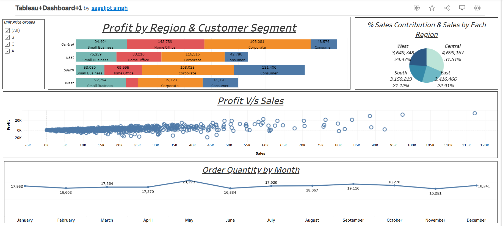
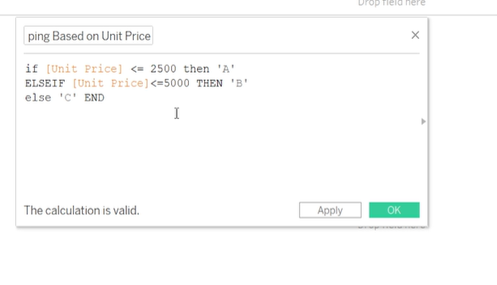

# 2. Superstore Sales Analysis | Tableau

An interactive sales and profit analysis project developed using Tableau and the Sample Superstore dataset. This project focuses on exploring regional sales performance, customer segments, profitability, and monthly order quantities through interactive visualizations and calculated fields.

## Project Overview

The objective of this project is to analyze retail sales data and identify patterns in sales performance, profitability, and customer purchasing behavior.

Using Tableau, the project presents business insights through charts, filters, calculated fields, and dashboard visualizations.

## Tools & Technologies

- **Tableau Desktop** – Dashboard development and data visualization
- **Microsoft Excel** – Dataset storage and data handling
- **Calculated Fields** – Custom categories and data segmentation

## Repository Structure

```text
03-Tableau-Superstore-Sales-Analysis/
│
├── Dataset/
│   └── Sample_Superstore_Sales.xls
│
├── Tableau/
│   └── Tableau_Dashboard_1.twbx
│
├── Screenshots/
│   ├── Sales_Dashboard.png
│   └── Calculated_Field.png
│
└── README.md
```

## Dataset Description

The project uses the Sample Superstore Sales dataset, which contains retail sales information.

The dataset is used to analyze:

- Sales
- Profit
- Order Quantity
- Region
- Customer Segment
- Unit Price
- Monthly Sales and Orders

## Tableau Dashboard & Analysis

The dashboard includes the following visualizations:

### 1. Profit by Region & Customer Segment

Analyzes profit distribution across different geographical regions and customer segments, including:

- Consumer
- Corporate
- Home Office
- Small Business

### 2. Sales Contribution by Region

A pie chart representing the percentage contribution of each region to total sales.

Regions analyzed:

- Central
- East
- South
- West

### 3. Profit vs Sales Analysis

A scatter plot used to explore the relationship between sales and profit and identify variations in profitability across orders.

### 4. Order Quantity by Month

A monthly trend visualization showing order quantities from January to December.

## Calculated Fields & Filters

A custom calculated field named `ping Based on Unit Price` was created to categorize products based on unit price.

The calculation uses the following conditions:

- Category A: Unit Price less than or equal to 2,500.
- Category B: Unit Price greater than 2,500 and less than or equal to 5,000.
- Category C: Unit Price greater than 5,000.

A Unit Price Groups filter was also added to enable interactive filtering of the dashboard.

## Dashboard Screenshots

### Sales & Profit Analysis Dashboard



### Calculated Field – Unit Price Grouping



## How to Run the Project

1. Clone or download this repository.
2. Open the packaged Tableau workbook (`.twbx`) using Tableau Desktop.
3. If required, reconnect the data source.
4. Explore the dashboard using the available filters and visualizations.
5. Interact with charts to analyze sales and profitability patterns.

## Key Learning Outcomes

- Creating interactive Tableau dashboards.
- Analyzing sales and profit performance.
- Using calculated fields for data categorization.
- Applying filters for interactive analysis.
- Understanding regional sales contributions.
- Comparing customer segments.
- Analyzing monthly order trends.
- Exploring relationships between sales and profit.

## Author

**Sagaljot Singh**

---

*If you find this project useful, feel free to star this repository.*
